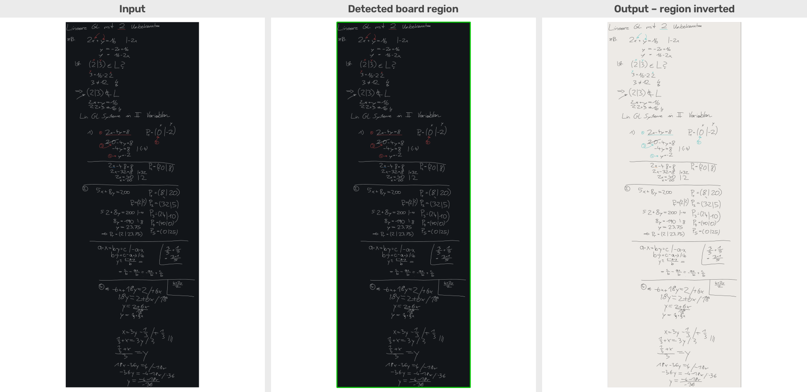

# Smartboard PDF Inverter

Selectively invert the smartboard area of PDF documents — nothing else.

Smartboard PDF Inverter automatically detects the rectangular smartboard
(whiteboard) region on every page of a PDF and inverts **only that area**
(strict `255 − v` per pixel channel). The white page around the board, the page
size, the board's position, and the page order are preserved exactly:
everything outside the detected rectangle is left pixel-identical.

<p align="center">
  
</p>

*Detection and selective inversion on the bundled sample file: the board region
is found automatically (green outline) and inverted; the surrounding page is
untouched.*

## Highlights

- **Automatic detection** — background-relative thresholding combined with
  plausibility gates (area, rectangularity, contrast, page margin, ambiguity)
  and a confidence score. If no unambiguous region is found, the page is left
  unchanged and a warning is emitted — the whole page can never be inverted by
  accident.
- **Strictly selective inversion** — the strict pixel transformation
  `255 − v` is applied inside the detected rectangle only.
- **Page-faithful output** — original page size (MediaBox), board position, and
  page order are preserved. Four output strategies, chosen per page:
  lossless page copy, in-place board-image replacement (lossless PNG),
  **vector-preserving inversion** (colour operators rewritten in the content
  stream, so vector/SVG board content stays vector-sharp at any DPI — since
  v0.8.0), or re-embedding of a rendered page at the original size (raster
  fallback).
- **Built-in verification** — every processed page is re-rendered and compared
  against the original; pixels outside the region must be unchanged (the
  numbers are logged and available in the API).
- **Batch processing** — process a single file or an entire directory in one
  command.
- **CLI and GUI** — a command-line interface (`smartinvert`) and a small
  Tkinter GUI with live preview and progress reporting.
- **Safe by design** — the input file is never modified; rotated pages and
  ambiguous content fail safe (copied unchanged, never wrongly inverted).

## How it works

1. **Detection** — each page is rendered at the configured DPI. A deterministic
   background-relative threshold (`T = B − max(30, 0.25·(B − p25))`,
   `B = p95`) plus morphological closing and connected-component analysis
   yields candidate regions; hard gates on area, dimensions, rectangularity,
   margin, contrast, and a second-largest-candidate ratio select the board.
   Details: [ADR 0001](docs/adr/0001-robuste-erkennung-und-seitentreue-ausgabe.md).
2. **Transformation** — inside the rectangle only: strict inversion
   (`255 − v`) or a linear per-channel remap onto a target background colour
   (`--bg-target R,G,B`, e.g. pure white `255,255,255` for dark boards).
   Marker colours can be preserved and left un-inverted
   (`--keep-colors`; default `red,green`, since v0.5.0), and explicit hex
   colours / ranges can be excluded as well (`--keep-hex`, since v0.6.0).
3. **Output** — one of the four strategies above is applied. **Vector board
   pages** (the board is drawn with vector paths, e.g. an exported
   lecture/SVG document) are inverted *in the content stream* — the colour
   operators are rewritten per paint while geometry, text, and fonts stay
   vector, so the result is sharp at any DPI instead of a rasterised bitmap
   (ADR 0008, `method = vector-invert`). Anything the rewrite cannot handle
   exactly (transparency, shadings, inline images, …) self-heals to the
   raster fallback, so output can never degrade. For those vector pages the
   default crop is likewise **vector-exact** (a content-stream clip instead
   of a rendered slice). Since v0.7.1 (ADR 0006) the finished document is
   afterwards re-wrapped **by default** (ADR 0003) so every page with a
   detected board is sized to exactly that rectangle — the page boundaries
   contain only the visible board area (GUI checkbox „Auf Board zuschneiden
   (Rand entfernen)", enabled by default; `--no-crop` / unchecking it keeps
   the unchanged page-faithful output). Pages without a board keep their full
   size.
4. **Verification & debug** — the output page is re-rendered at the same DPI
   and compared with the input (max/mean diff outside and inside the region);
   `--debug` writes per-page composites
   (`original | original + rectangle | result`) to `<output>/debug/`.

## Quick start

> Step-by-step installation guide (Windows, macOS, Linux), including
> troubleshooting: see **[INSTALL.md](INSTALL.md)**.

**No prerequisites** — the starter script sets up everything on its own,
including a private Python interpreter (managed by
[uv](https://docs.astral.sh/uv/)). It works regardless of whether Python is
installed on the system (or which version).

```bash
git clone https://github.com/univie-henrikjurek/smartinvert.git
cd smartinvert

./start.sh -i test_input.pdf -o test_output.pdf   # Linux / macOS
.\start.bat -i test_input.pdf -o test_output.pdf  # Windows (PowerShell)
```

First run: the starter installs `uv` (~15 MB, one-time), fetches a private
Python 3.12, and creates a virtual environment in `.venv/` with all
dependencies — roughly 1–3 minutes once; every later start is instant.
**Running the starter without arguments opens the GUI.** On systems where
`uv` cannot be installed, the starter transparently falls back to the system
Python (3.9 or newer).

```bash
# Batch: all PDFs in a directory (output files keep their names)
./start.sh -i inputs/ -o outputs/ --debug

# Higher output quality (detection + embedding resolution)
./start.sh -i inputs/test.pdf -o out.pdf --dpi 300
```

Without `-o`, a single input file produces `<name>_inverted.pdf` next to the
input (legacy behaviour).

## Command line

After the first run the tool is also available directly as the
`smartinvert` command (inside `.venv/`, or on your PATH after activation).

```
Usage: smartinvert -i INPUT [-o OUTPUT] [options]

  -i, --input PATH        Input PDF file or directory (default: inputs/)
  -o, --output PATH       Output file (file input) or directory
                          (default: outputs/, same file names)
      --dpi N             Rendering DPI for detection and output
                          (default: 150, range 20–600)
       --invert / --no-invert
                           Invert the detected region (default: enabled)
       --crop / --no-crop  Size each output page to its detected board
                          rectangle; pages without a board keep their full
                          size (default: on since v0.7.1; --no-crop keeps
                          the page-faithful output)
      --bg-target SPEC    Target background of the board: 'complement'
                          (strict 255 − v) or 'R,G,B' (each 0–255), e.g.
                          '255,255,255' = pure white
                          (default: complement)
      --keep-colors LIST  Marker colours left un-inverted (comma-separated
                          from red,green,blue,yellow; 'none' = invert
                          everything). Default: red,green
      --keep-hex SPEC     Additional colours / colour ranges (hex) left
                          un-inverted, comma-separated 'RRGGBB' or
                          'RRGGBB-RRGGBB', e.g. 'FF0000, 00FF00,
                          000001-0000FF'. Empty = off (default)
      --debug             Write per-page debug composites to <output>/debug/
      --config PATH       Optional JSON config file; CLI flags take precedence
  -v / -vv                Log level INFO / DEBUG
      --version           Show version and exit
```

Exit code: `0` on success, `1` if at least one file failed (a batch continues
past failing files). Run `smartinvert --help` for the full reference.

> Since v0.5.0 the default is `--keep-colors red,green` (red/green marker
> colours are preserved). For the exact v0.4.1 behaviour use
> `--bg-target complement --keep-colors none`.

> `--keep-hex` (since v0.6.0): each entry is either a single colour
> (`RRGGBB`; `#` prefix and 3-digit shorthand allowed, e.g. `#F00`) or a
> range (`RRGGBB-RRGGBB`, endpoints in either order) that covers every
> colour within a distance of 50 from the segment between the endpoints —
> e.g. `000001-0000FF` keeps the whole blue axis from darkest to lightest
> blue. A pixel is only excluded when it is also sufficiently saturated
> (chroma ≥ 24): neutral grays, in particular the dark board background,
> are never excluded.

## Config file

`--config PATH` loads a JSON file holding any of the options `input`,
`output`, `dpi`, `invert`, `crop`, `bg_target`, `keep_colors`, `keep_hex`
and `debug`. `null` or a missing key uses the default, and explicit CLI
flags always take precedence. String options use CLI syntax (e.g.
`"bg_target": "255,255,255"`, `"keep_colors": "red,green"`,
`"keep_hex": "FF0000, 000001-0000FF"`). Old configs containing the removed
`clahe`/`clean` keys (removed in v0.7.0) are simply ignored.

## GUI

Open the GUI by running the starter without arguments (or double-click
`start.bat` on Windows):

```bash
./start.sh        # Linux / macOS
start.bat         # Windows
```

- **PDF…** — select one file, or **Folder…** — process a whole directory
  (batch)
- **Output (optional)** — destination file/folder; leave empty for the default
  `<name>_inverted.pdf` next to the input (folder input requires an output
  folder)
- **DPI** slider (default 150; raise to 300 for sharper results)
- **Auf Board zuschneiden (Rand entfernen)** — sizes each page with a
  detected board to exactly that rectangle, removing the surrounding page
  margin (default: on since v0.7.1 — the page then contains only the
  visible board area)
- **Zielhintergrund** — target background of the board: *Complement (255 − v)*
  (default) or *Reinweiß (255,255,255)*
- The red/green marker colours are always kept un-inverted (the former
  "Rot/Grün erhalten" checkboxes were removed in v0.7.0 as redundant)
- **Zusätzliche Hex-Farben** — explicit hex colours / ranges left
  un-inverted, same syntax as `--keep-hex` (e.g. `FF0000, 00FF00,
  000001-0000FF`; empty = off, since v0.6.0). Blue/yellow and free `R,G,B`
  targets are CLI-only
- **Preview first page** — original and processed page side by side
- **Run** — processes with a progress bar and reports the output location

## Project layout

```
smartboard_invert/
  detection.py    # Rectangle detection (threshold, gates, confidence, refinement)
  processing.py   # Image transformations (255 − v, remap, keep masks), PDF ⇄ images
  pdfpipeline.py  # process_pdf(): three output strategies, verification, debug
  cli.py          # Batch CLI with JSON config support
  gui.py          # Tkinter GUI
  __main__.py     # python -m smartboard_invert entry point
docs/adr/         # Architecture decision records
tests/            # pytest suite with synthetic PDF fixtures (ground truth)
```

## Development

```bash
python3 -m venv .venv
.venv/bin/pip install -e .            # editable install
.venv/bin/pip install pytest pytest-cov
.venv/bin/pytest --cov=smartboard_invert --cov-report=term-missing
```

The test suite covers detection, processing, the end-to-end pipeline
(including the mandatory scenario set), and the CLI, with an 80 % coverage
gate. CI (GitHub Actions) runs the suite on Python 3.10 and 3.13, installs the
package the same way end users do, and executes a smoke test on the bundled
sample. See [STATUS.md](STATUS.md) for the current project state.

## License

[MIT](LICENSE) — free to use, modify, and distribute, including commercially;
the only obligation is to keep the copyright and license notice.
